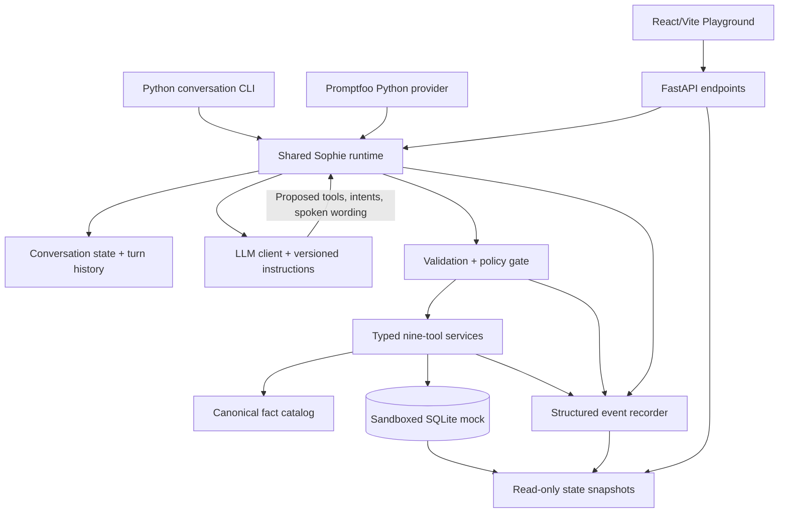

# Sophie — Phase 4 Technical Architecture (v1.0)

**Project:** Further AI Engineer take-home, Sophie / ACME Senior Living  
**Prepared:** November 11, 2026  
**Status:** Architecture decisions for Codex implementation; no application has yet been implemented  
**Inputs:** original assignment (`Pasted text(5).txt`), Phase 1 audit, Phase 2 PRD, Phase 3 demo spec, Phase 3 scenario catalog  
**Next:** Phase 5 evaluation plan, then Codex implementation

## 0. Executive decision

Build a **hybrid tool-calling agent**. The LLM owns flexible language understanding and natural spoken wording. Python owns authoritative facts, date/time normalization, validation, permissions, transaction execution, confirmation, and outcome truth. A single agent runtime powers the web playground, CLI, and promptfoo; none has an alternative mock conversational implementation.

A final response is not proof of any side effect. Only validated backend state can establish that a tour is booked, moved, or canceled.

### Decisions at a glance

| ADR | Decision | Status |
|---|---|---|
| A01 | Custom, explicit Python tool-calling orchestration loop instead of LangGraph | Adopted |
| A02 | LLM interprets/proposes; application guards and validates operations | Adopted |
| A03 | FastAPI app; React + TypeScript + Vite playground | Adopted |
| A04 | SQLite backed mock with transactional updates and sandbox isolation | Adopted |
| A05 | Structured canonical fact catalog with provenance; no factual hardcoding in model prompt | Adopted |
| A06 | One persisted conversation state and turn log per sandbox/session | Adopted |
| A07 | Shared service layer used by UI/API, Python CLI and promptfoo provider | Adopted |
| A08 | Configurable OpenAI model through the Responses API with strict tool schemas when supported | Adopted as default; model ID intentionally configurable |
| A09 | Typed, redacted structured events for evaluation and playground inspector | Adopted |
| A10 | Reproducible scenario fixtures, injected clock, explicitly test-only fault mechanisms | Adopted |
| A11 | First implementation uses request/response HTTP; add SSE only if measured demo/UX demands it | Adopted |
| A12 | Original provided prompt/tools/mock/seed evals preserved unmodified for baseline reconstruction | Adopted |

## 1. Component boundaries



**Runtime (not UI) is the product.** API and provider invoke the same `SophieRuntime.handle_turn(...)` entrypoint. The LLM never directly writes to SQLite, selects arbitrary source URLs, or edits community policy.

**Dependency direction:** frontend → HTTP API → agent runtime → service/policy interfaces → mock implementation. The runtime should depend on interfaces, not import module-global `TOURS`/`LEADS` state. This makes it possible to use real services later without redesigning the agent.

## 2. Framework and library tradeoffs

| Candidate | Decision | Reason |
|---|---|---|
| Python 3.11+ | Use | Original mock and assignment/provider ecosystem are Python-friendly. |
| FastAPI/Pydantic | Use | Explicit request and tool types, familiar testing, documented HTTP boundary. |
| OpenAI SDK Responses API | Use as initial provider | Supports application-managed function calling and strict JSON schema; configuration isolates model choice. |
| LangGraph | Do not introduce initially | Nine tools and one principal agent do not justify graph checkpointing and routing overhead yet. Reconsider if real parallel subagents or complex recoverable graphs emerge. |
| Multi-agent specialist router | Do not build | More calls, harder tracing, and no requirement needing it. |
| SQLite | Use | Local, reproducible, portable; transactions and indexes are sufficient for a take-home mock. |
| In-memory dictionaries | Only in explicitly isolated unit tests/baseline | No reliable reset, cross-request observation, or transactional guarantees for the demo. |
| React/TypeScript/Vite | Use | Lightweight inspector UI with typed API contracts; no SSR framework requirement. |
| SSE/WebSockets | Defer | Not necessary for text-in/text-out turn completion. Show honest request status, then inspect actual event sequence. Add if measured lag warrants real-time event streaming. |
| Vector database/RAG | Do not use | Community fact catalog is small, structured, and exact; semantic retrieval increases unnecessary uncertainty. |
| Tracing vendor | Optional later | In-process structured events suffice for replay/evidence; OpenTelemetry can be added behind interfaces. |

**Model policy:** use `OPENAI_MODEL` environment setting. Start with one tool-capable model and record its version. Don't claim a model's numerical accuracy, latency or cost until actual runs. The API adapter is small enough to swap models/providers if measurements justify it. Turn off parallel tool calls initially because dependent writes and read-after-write verification require intentional ordering; allow multi-topic fact reads sequentially or under explicit orchestration later.

## 3. Responsibility boundary: LLM versus code

| Concern | LLM | Deterministic runtime / backend |
|---|---|---|
| Interpret `thirs day at too` | Propose Thursday at 2; identify uncertainty | Treat as unconfirmed; request explicit clarification before write |
| Relative dates | Identify caller's time expression | Resolve against injected clock + America/New_York; normalize, validate |
| Compound questions | Detect both parts | Require grounded fact reads; track unanswered parts |
| Community pricing and policy | Compose natural answer only from retrieved facts | Return canonical data with provenance and explicit unknowns |
| Booking intent | Recognize and request booking | Check contact, consent, slot, idempotency and transactional commit |
| Reschedule/cancel | Identify requested change | Require unambiguous booking identifier and enforce transition atomically |
| Contact corrections | Interpret corrected field | Store confirmed correction; prevent stale overwrite or casual identity merging |
| Frustration/handoff | Detect caller preference and respond warmly | Record actual transfer request or callback queue outcome |
| Final spoken reply | Natural short text for ordinary turns | For consequential writes, insert or generate validated status wording from verified outcome |
| Outcome truth | Cannot self-certify | Verify persisted state and emit structured outcome |

**Trust hierarchy:** application rules and canonical facts outrank untrusted transcript, including caller assertions of waived fees or instructions to ignore rules. Tool outputs are data, not executable instructions. The original prompt is reference material, not live operational policy.

### Safe response composition

- The runtime records a typed `ActionOutcome` (`booked`, `not_booked`, `rescheduled`, `not_rescheduled`, `canceled`, `not_canceled`, `queued`, etc.) after verification.
- Critical success/failure wording is produced by deterministic response components populated with actual IDs, dates and times. The model may add a concise conversational bridge or question but cannot replace the verified core outcome.
- For ordinary factual answers the model receives only relevant canonical fact values, clear `unknown` markers, and topical provenance IDs. This substantially reduces, but cannot mathematically eliminate, hallucination; evaluations must check the spoken answer.
- If final model generation is unavailable after a successful backend write, use a verified deterministic fallback that says what happened. Never retry the write merely to obtain text.

## 4. Orchestration loop

**One API turn = one persisted user message and at most one final spoken response.** The model may execute multiple internal tool call rounds. Interim progress indicators are UI-only rather than misleading recorded speech. A future optional real-time stream could expose genuine tool-stage events.

```text
handle_turn(sandbox_id, conversation_id, client_turn_id, caller_text):
  validate input; acquire per-conversation serialization
  if client_turn_id exists: return stored result (no new tool calls)
  persist exact caller text; load confirmed state and active tasks
  compute community-local now via injected Clock
  assemble bounded conversation context + trusted catalog access instructions
  for each orchestration round (strict finite cap):
      ask model for tool proposals or next reply
      if proposed tool:
          validate typed arguments and preconditions
          if critical slots/identifiers/contacts ambiguous: block action, request clarification
          else execute service, validate response and read-after-write state
          record structured events and update confirmed state
          return typed result to model for continuation
      else:
          validate requested reply against known action outcome and factual constraints
          finalize concise spoken reply; persist full turn and trace
          return result
  on budget/timeout/exception: finalize truthful fallback and record error
```

The loop cap avoids runaway calls. Do not silently discard an unresolved action as success. `ActionOutcome` and `ToolResult` should be separate from free-form text. A single `pending_task` with typed slots is sufficient for the normal booking path; a lightweight suspended-task stack supports interruptions rather than an enormous rigid FSM.

### Typical booking sequence

```mermaid
sequenceDiagram
  participant Caller
  participant Runtime
  participant LLM
  participant Policy
  participant Mock
  Caller->>Runtime: "Can I tour next Wednesday at ten?"
  Runtime->>LLM: Transcript + confirmed context + policy instructions
  LLM-->>Runtime: Propose availability lookup
  Runtime->>Policy: Normalize/validate day and time
  Policy->>Mock: check_tour_availability(date)
  Mock-->>Policy: Available UTC slot list
  Policy-->>Runtime: Local verified slot membership
  Runtime-->>Caller: Request missing confirmed contact details if needed
  Caller->>Runtime: Name/contact; explicitly confirm booking
  Runtime->>Policy: Validate all booking prerequisites
  Policy->>Mock: book_tour(..., operation_id)
  Mock-->>Policy: Result
  Policy->>Mock: Read booking by confirmation/operation id
  Mock-->>Policy: Persisted status/time/contact (or no record)
  Policy-->>Runtime: Typed verified outcome
  Runtime-->>Caller: Accurate confirmation OR explicit failure and alternative
```

The sample sketch is a multi-turn sequence, not a claim that the LLM uses a specified number of calls. If a Wednesday 10 a.m. race is injected, the booking response must not be treated as a success and no confirmation phrase is emitted.

## 5. Typed state model

### `ConversationState`

```text
sandbox_id, conversation_id, revision, started_at, updated_at
simulation_clock: injected local datetime or live Clock
lead_id: optional stable lead reference
confirmed_contact: {first_name?, last_name?, phone?, email?}
contact_confirmation: per-field confirmed / tentative / correction_pending
interest: {care_type?, prospective_resident_relationship?, move_timing?}
pending_task: {type, stage, slots, last_question?, action_intent_confirmed?} | null
suspended_tasks: short stack/list for interrupted tasks
active_tour_ids: references, not copies of authoritative tour state
last_tool_outcome: typed result reference
last_turn_id, last_spoken_response
```

**The state stores knowledge and intent, not invented facts.** A proposed slot is distinct from a checked slot; a checked slot is distinct from a booked tour. Storing a tour ID in session memory is only a reference: subsequent confirmation queries the backend.

### Explicit stages where an action matters

- Booking: `collecting_slot` → `slot_checked` → `collecting_contact` → `awaiting_confirmation` → `executing` → `confirmed` / `failed`.
- Reschedule: `identify_tour` → `check_new_slot` → `awaiting_confirmation` → `executing` → `confirmed` / `failed`.
- Cancellation: `identify_tour` → `awaiting_confirmation` → `executing` → `confirmed` / `failed`.
- Callback/brochure: `collect_required_details` → `awaiting_confirmation` → `queued` / `failed`.

Not every stage needs to be shown to the caller; stage boundaries are for preventing unsupported writes. An explicit caller instruction such as “Cancel my tour T-...” can count as action consent after target ambiguity is resolved; do not create artificial confirmation loops for every request.

### Correcting contact information

New information can be tentative until clarified. On explicit correction, replace the previous field in conversation state, then upsert using the stable `lead_id`. Never identify callers solely by fuzzy/spoken phone equality; the inherited phone-match upsert is insufficient for safe corrections. A corrected phone must not create a second lead for the same in-session person.

## 6. Canonical fact registry

Version a compact structured fixture (`data/community_facts.json` or YAML) with fields such as:

```json
{
  "topic": "pricing",
  "key": "entrance_fee",
  "value": 3500,
  "unit": "USD",
  "source": "mock-original",
  "status": "known",
  "revision": "fixture-v1"
}
```

The `get_community_info` adapter retrieves only matched topics/fields and returns `known`, `unknown`, or `needs_staff_confirmation`, not a bare `{}` pretending to be an answer. Include the original mock facts exactly, then selectively migrate clear, low-risk legacy facts with `source=legacy_prompt_migration` and tests. Never auto-import prompt contradictions or high-impact care/payment guarantees.

Core original mock facts: $2,000 independent-living start, $3,000 assisted-living start, $3,500 entrance fee, independent/assisted care, no dedicated memory care, dogs up to 30 lb, original room types, phone and address. Explicitly unknown: exact two-bedroom pricing, individual thermostats, kosher meals, promotional waiver, current nursing openings, purchasing department identity. Additional listed amenities and low-sodium diet can be migrated as fictional demo fixture data with documented provenance.

A `FACT_NOT_FOUND` outcome is intentional product behavior: state what is known, identify missing detail, offer staff handoff. Do not use public web search for community policies: fictional ACME facts are internal to the assignment.

## 7. Tool contracts and service layer

Keep **all nine original tool names** for fidelity. Repair schema/type mismatches and add optional internal metadata through adapters rather than exposing unsafe backend details to the model.

| Tool | Required deterministic checks | Outcome evidence |
|---|---|---|
| `get_community_info` | Allowlisted topic; provenance and known/unknown status | Canonical fact refs and scope |
| `check_tour_availability` | ISO date, future, M–F, timezone-safe UTC→ET conversion; blocked schedule | Authorized slots with explicit local representations |
| `book_tour` | Checked future slot; confirmed first name + reachable contact; actual availability at commit; idempotency | Real booking ID and matching persisted booking |
| `reschedule_tour` | Existing active tour; new checked slot; transactional update; shared confirmation ID | Same tour ID with verified new date/time; prior state on failure |
| `cancel_tour` | Existing active tour; unambiguous target; idempotent repeated operation reporting | Persisted `canceled`, distinguish already canceled/not found |
| `upsert_lead` | Meaningful identity/contact/notes; stable lead ref; corrections replace; no blank eager inserts | Actual updated lead record |
| `schedule_callback` | Existing lead with reachable contact; provided preference; dedup | Persisted queued callback request |
| `transfer_to_human` | Explicit request or accepted offer; no real telephony in mock | Persisted transfer-request event, not live connection |
| `send_brochure` | Existing lead, complete verified postal address, dedup | Persisted queued brochure request, not physical delivery |

**Contract repair:** supplied reschedule JSON schema says `tour_id`, while inherited Python function takes `confirmation_id`; standardize on `confirmation_id` at the canonical service boundary, and document compatibility mapping if the old tool spec is preserved in baseline tests. **Contact integration repair:** the inherited `book_tour` has no email or `lead_id` field even though our product policy permits email-only contact. Extend the repaired internal booking tool/service with a validated `lead_id` (and link the persisted tour to that lead); an email-only caller can then book without inventing a phone number. Likewise, extend the repaired upsert contract to accept an existing `lead_id` to update the same logical person after contact correction. This is an explicitly documented change to the inherited tool contract, allowed by the assignment. Preserve original assets in `inherited/` untouched.

**API/output shapes:** use `ToolResult<T>` with `ok: bool`, `code: enum`, `data`, `operation_id`, `state_verified: bool`, and optional safe `message`. `ok` must be **false** if an error field exists or required confirmation evidence is missing; unexpected or conflicting payloads become `BACKEND_CONTRACT_ERROR`.

### Read-after-write verification

- `book_tour`: ID not blank, tour row exists, status `booked`, date/time, contact and sandbox match. If no reliable read is available, report *not confirmed* rather than invent success.
- `reschedule_tour`: existing ID is still present, status `booked`, new date/time match. When failure occurs, previous row unchanged.
- `cancel_tour`: existing booking was active and is now canceled. If already canceled, truthful status but not a claim of newly canceling it.
- Queued requests: record exists with correct lead/address/preference and correct `queued` status.

Do not repeatedly execute non-idempotent actions on a timeout or unclear response. First reconcile by `operation_id`. If the outcome remains ambiguous, ask for staff assistance or state clearly that it could not be confirmed.

## 8. Persistence and isolation

**Chosen persistence:** a local SQLite database in `data/runtime/`, created/migrated at app startup. In tests, create isolated temporary DBs. All business tables carry `sandbox_id`; all sessions carry `conversation_id` and a monotonic revision.

Suggested tables:

```text
sandboxes(id, scenario_id, fixture_revision, simulated_now, created_at)
conversations(id, sandbox_id, state_json, revision, created_at, updated_at)
turns(id, sandbox_id, conversation_id, client_turn_id, caller_text,
      spoken_text, status, operation_summary_json, created_at)
events(id, sandbox_id, conversation_id, turn_id, seq, type, payload_json, created_at)
leads(id, sandbox_id, first_name, last_name, phone, email, notes, created_at, updated_at)
tours(id, sandbox_id, lead_id, local_date, local_time, status, source, created_at, updated_at)
callbacks(id, sandbox_id, lead_id, best_time, status, operation_id)
transfers(id, sandbox_id, reason, status, operation_id)
brochures(id, sandbox_id, lead_id, postal_address, status, operation_id)
operations(id, sandbox_id, operation_type, idempotency_key, status,
           result_json, created_at, updated_at)
```

**Integrity rules:**

- Unique `(sandbox_id, conversation_id, client_turn_id)` prevents double-sent turns.
- Unique `(sandbox_id, operation_type, idempotency_key)` prevents repeated effects for the same action.
- A partial unique constraint on `(sandbox_id, local_date, local_time) WHERE status = 'booked'` prevents two active tours occupying the same fixture slot. Tuesday 2 p.m. is blocked separately by the calendar service.
- Booking/reschedule use `BEGIN IMMEDIATE` and validate the slot **inside the write transaction**; a previous availability read alone is insufficient.
- Reschedule updates the same tour row atomically after checking the new slot; an unavailable target never destroys or moves the original.
- Cancellation validates existence and active state rather than using `dict.get(...,{})` and reporting blanket success.
- Store all timestamps with explicit UTC offsets for audit; store tour local date/time with `America/New_York` association for display. Do not silently compare naive datetimes to aware ones.

**Scope caution:** this is an effective sandbox persistence model, not a claim of production-grade distributed transactions. Real external CRMs/calendar services would need explicit consistency, authentication, and retry/reconciliation design.

## 9. Date/time handling

- Inject a `Clock` interface (`now_utc`, `now_community`) into runtime and availability services. No hardcoded March 2025 date.
- Canonical community timezone: `America/New_York`, not an always-fixed `EST` offset.
- Tools receive normalized date `YYYY-MM-DD` and time `HH:MM` in community-local interpretation. Returned UTC slot strings are converted to local and matched by actual instant/slot identity.
- Weekdays: Monday–Friday. The inherited `_is_open_day` uses `not in (0,6)` and must be corrected to `weekday() < 5`.
- Tuesday 14:00 staff meeting remains blocked. The inherited Wednesday 10:00 loss is modeled as an explicit test fault rather than embedded false success in standard production behavior.
- Never book a past time, a closed weekday, an unreturned slot, or an invalid local time.
- Do not invent tour duration or impose an unsupported 5 p.m. last start if the canonical backend returns an 18:00 start. Document this demo assumption.
- For ambiguous `next Tuesday` interpretation or noisy `at too`, return an explicit proposed local date/time and ask for confirmation before a write. For deterministic tests, specify the reference clock and desired date interpretation.

## 10. API contract for playground

The web app is a thin client: it may inspect events and state but never call business tools or write a tour directly.

| Method and path | Responsibility | Key response fields |
|---|---|---|
| `GET /api/scenarios` | List scenario IDs, labels, descriptions, suggested caller turns | array of scenario metadata |
| `POST /api/sandboxes` | Create fresh sandbox; optional preset | `sandbox_id`, `conversation_id`, `clock`, `fixture_summary` |
| `POST /api/sandboxes/{id}/reset` | Clear and deterministically reseed sandbox | new/revised `conversation_id`, fixture summary |
| `POST /api/conversations/{id}/turns` | Submit caller transcript to actual runtime | `turn_id`, `spoken_text`, `action_outcomes`, `duration_ms`, `trace_id` |
| `GET /api/conversations/{id}/turns` | Retrieve genuine conversation transcript | exact caller/Sophie turns |
| `GET /api/conversations/{id}/events` | Read tool/validation timeline | ordered redacted events |
| `GET /api/sandboxes/{id}/state` | Read-only verified backend snapshot | tours, leads, transfers, callbacks, brochures |
| `GET /api/sandboxes/{id}/facts` | Read-only catalog and provenance | topics, known/unknown state, origin |
| `GET /api/evaluations` | List imported/linked saved eval results, may be empty | run metadata, genuine metrics only |

**Turn request:** `{client_turn_id: UUID, text: string}`. A UI double-send or network retry with the same UUID must return the original result, not create another booking. An explicit new caller decision must use a new ID. API errors have machine-readable codes and user-safe messages.

**Transport decision:** ordinary JSON request/response is the initial canonical path. During execution show a truthful generic `Processing caller turn…` state and disable duplicate send. On completion show recorded tool/validation events in order. Add event-stream progress only if needed; never show a fabricated stage (e.g. `Booking...`) before it actually occurs.

## 11. Observability model

Every turn produces a `trace_id` and ordered events, e.g.:

```text
turn.received
model.requested
model.tool_proposed
policy.validation_passed | policy.validation_failed
backend.tool_started
backend.tool_finished | backend.tool_error
backend.state_verified | backend.state_unverified
response.finalized
```

Event payloads must include safe tool name, normalized arguments (mask phone/email/address in default logs), result status/error code, duration, relevant fact IDs, and authoritative state diffs. Keep sensitive raw values in sandbox state if necessary for correctness, but not in exported logs/screenshots by default. API secrets and chain-of-thought must never appear in traces. Show only documented tool inputs/outcomes, not private model reasoning.

**Latency:** collect observed end-to-end time, model time, tool time and validation time. Use percentile summaries only with genuine samples and disclose sample size and conditions. If real voice latency requires streaming later, instrument before adding complexity.

## 12. Scenario engine and test-only faults

A scenario is data, not scripted output:

```text
id, title, fixed_local_now, initial_leads, initial_tours,
suggested_utterances, selected_faults, expected_state_invariants
```

Loading a scenario creates fresh isolated state and an explicit UI label `Preloaded test booking` where appropriate. Suggested turns may fill the composer but do not bypass model execution. All scenario dates are calculated from declared fixture clocks, not ambient current time.

Test-only faults, controlled by allowlisted scenario IDs and rejected in normal mode:

1. `race_slot_taken_on_commit`: availability initially includes the slot, booking transaction rejects it later with explicit `SLOT_TAKEN` (simulates external reservation race). No booking is created **for the caller**.
2. `legacy_contradictory_booking_payload`: adapter receives `{success: true, confirmation_id: null, error: "slot_taken"}` and the validator rejects it, even though the success flag is true. Distinguish this from standard repaired behavior.
3. `delayed_tool_response` / `tool_timeout` to test uncertainty without accidental duplicate effects.
4. `repeat_same_turn_id` in API test to prove idempotency.

Test code must be able to replay states using a fixed random seed or deterministic IDs. Faults are disclosed in Debug View, not hidden as normal business behavior.

## 13. Security, privacy, and safety boundaries

- User transcript is untrusted content. Never grant it access to runtime instructions, secrets, fixture mutation or unapproved tools.
- Model-visible tool schema is a constrained subset. All tool arguments are typed and validated, including strict schema where supported and app-level policy independently.
- No network access from arbitrary model-generated URLs; community knowledge comes from the canonical fixture.
- No secrets in source, events, transcript exports, or evaluation artifacts; check in only `.env.example`.
- Use synthetic data for presets, Loom and tests. Mask PII by default in event inspector; allow explicit local detail inspection if needed for correction demonstration.
- The mock's acceptance of a booking ID is a **demo simplification**, not an adequate real-world identity verification mechanism. A real deployment would need caller authentication/authorization and privacy policy review before changing an existing person's booking.
- Do not turn known couples policy + dementia into a clinical suitability guarantee. Unknown care needs trigger staff follow-up.
- No real transfers, mailings, or callbacks occur. API/event wording reflects request/queue state.

## 14. Project organization and Codex contract

Suggested repository layout (adjust naming if Codex finds a compelling need, preserve boundaries):

```text
sophie/
  README.md
  AGENTS.md
  .env.example
  pyproject.toml
  package.json
  promptfooconfig.yaml
  provider.py
  inherited/                  # immutable copied prompt, tools, mock, seed eval
  docs/                       # phase specs, ADRs, assumptions, eval plan
  backend/
    app/main.py              # FastAPI assembly only
    api/                     # request/response handlers
    agent/runtime.py         # shared handle_turn orchestration
    agent/prompt.py          # versioned instructions
    agent/model_client.py    # Responses API adapter
    agent/state.py           # typed session/task state
    domain/                  # typed policies, tool contracts, outcome validators
    services/                # implementations for nine tools
    persistence/             # SQLite schema/repositories/transactions
    fixtures/                # scenario presets, fixed clocks, fact catalog
    telemetry/               # safe per-turn trace events
  frontend/
    src/                     # Playground, inspector, scenario drawer, eval view
  tests/
    unit/
    integration/
    api/
    scenarios/
  evals/
    seed_original/
    baseline_reconstructed/
    final/
    artifacts/
```

**Every entrypoint must call the same runtime:** CLI, FastAPI, and `provider.py`. Do not implement a separate simplistic evaluation-only chatbot. Tool names and original source data should be traceable to the provided assignment. Readme documents setup, commands, assumptions, limits, and why the original seed set was corrected.

## 15. Architecture-level acceptance tests

Before claiming the implementation is ready for Phase 5/6 handoff, it should be possible to prove:

1. A correct weekday available slot books exactly one persisted tour with the correct `confirmation_id`, date/time, identity and contact.
2. Monday is open when returned; Saturday/Sunday closed; Tuesday 2 p.m. blocked; selected dates resolved against injected clock.
3. Direct illegal booking, stale availability, and concurrent competition are rejected by backend transaction rules, not only model intent.
4. The inherited contradictory success payload never produces a booking acknowledgment.
5. Failed reschedule leaves original booking intact; cancellation of unknown ID returns not found; canceled booking stays canceled.
6. Same action/turn retry does not create duplicate tours, callbacks or brochures.
7. Corrected phone/email updates the original logical lead, rather than merging unrelated callers or duplicating lead records.
8. Unsupported/community policy claims never become `known` through caller input or model inference.
9. Every action in the inspector corresponds to a real call/result/state transition, using the same runtime as promptfoo.
10. Every scenario can reset to a deterministic starting clock, fixture, tool-fault state, and clean session.
11. No claims of live transfer, physically mailed brochure, or guaranteed callback occur in the sandbox.
12. On model/API failure, return a truthful, helpful response without inventing success or repeating a risky write.

## 16. Explicit implementation sequence (for Phase 6)

1. Preserve inherited assets and create typed model and service interfaces.
2. Build corrected canonical fact registry and reliable SQLite mock with isolated fixtures.
3. Implement transactional booking/reschedule/cancel and direct backend tests **before** adding LLM behavior.
4. Implement lead/contact changes, callback, transfer, brochure and their negative paths.
5. Implement shared runtime/tool policy gate and simple versioned prompt; add model client.
6. Validate main multi-turn scenarios against actual state.
7. Add FastAPI transport and CLI using the shared runtime.
8. Implement React playground and read-only inspector using real API data.
9. Implement/iterate promptfoo baseline and final regression set (Phase 5 will specify metrics/tests), then regression CI.
10. Review any measured latency/cost/quality pressure; only then consider SSE, caching or framework changes.

**Phase 4 completion statement:** Major stack, state, source-of-truth, service, transaction, orchestration, API, observability and scenario contracts are decided. Phase 5 should now define exact tests, assertions, metrics and gating before Codex coding begins. The architecture is a design deliverable, not implemented system evidence.
